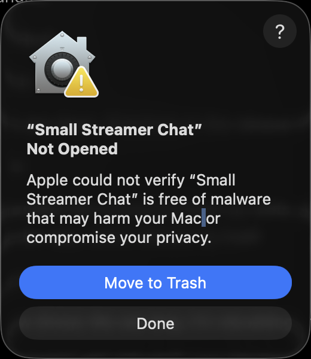
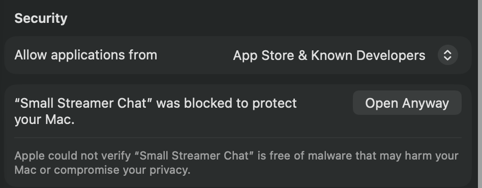
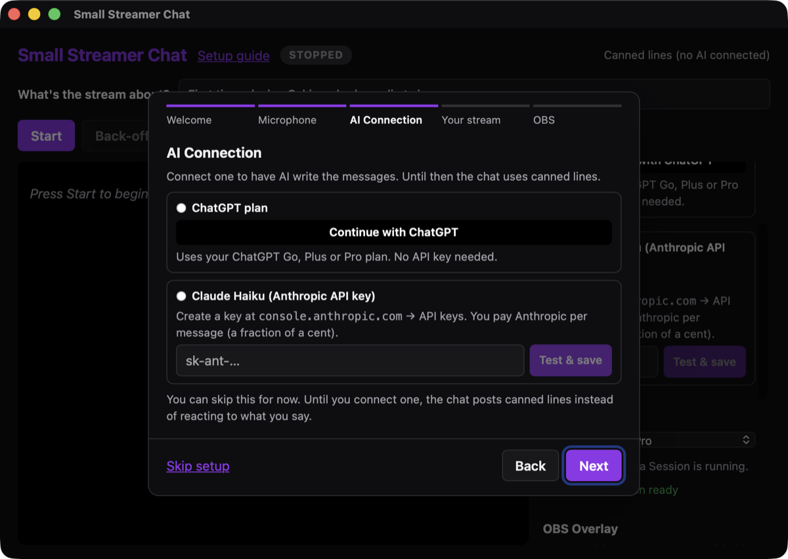
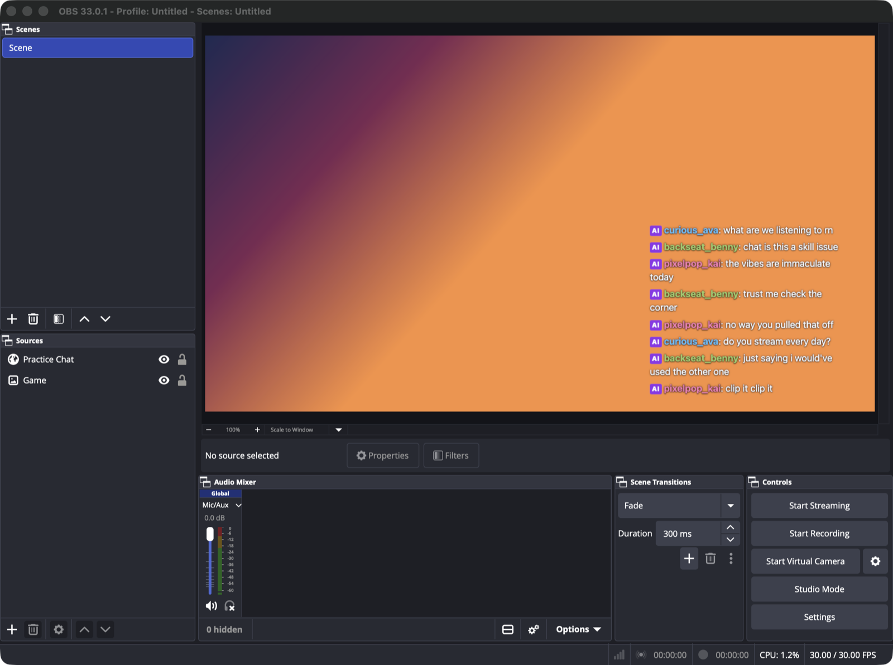

# Small Streamer Chat

**Streaming to an empty chat is hard. This gives you someone to talk to.**

Small Streamer Chat is a free desktop app for Windows and Mac. It listens to your microphone while you stream and shows a Practice Chat: AI chatters who react to what you actually say, ask you questions and tease you a little when you die to the same boss again. You get used to talking on stream before the real viewers arrive.

<!-- TODO: add docs/images/demo.gif: a 10–15 s clip of talking while the Overlay shows replies in OBS -->

- **It never posts anywhere.** It doesn't connect to Twitch, YouTube, Kick or TikTok, and it never reads your real chat. The Practice Chat lives on your computer and, if you want, in an OBS browser source.
- **Every message is labelled AI.** Viewers can always tell it's a practice tool, not fake viewers.
- **Your voice stays on your computer.** Speech is turned into text locally with [Whisper](https://github.com/ggml-org/whisper.cpp). Nothing is recorded or saved, and there's no telemetry.
- **Free and open source** (MIT). You bring the AI: sign in with your ChatGPT plan, or use an Anthropic API key (a few cents for a long stream). Without either, it posts canned lines.

## Install

Download the installer from the [latest release](https://github.com/cduym622/small-streamer-chat/releases/latest):

| Computer | File |
|---|---|
| Windows 10 or 11 | `Small.Streamer.Chat_x.y.z_x64-setup.exe` |
| Mac with Apple Silicon (M1 or newer) | `Small.Streamer.Chat_x.y.z_aarch64.dmg` |
| Mac with Intel | `Small.Streamer.Chat_x.y.z_x64.dmg` |

The app isn't code-signed (that costs money every year), so your computer warns you the first time. This is expected.

### Windows

1. Open the `-setup.exe` file.
2. If Windows says **"Windows protected your PC"**, click **More info**, then **Run anyway**.

<!-- TODO: add docs/images/windows-smartscreen.png -->

3. Follow the installer. Small Streamer Chat opens when it's done.

### Mac

1. Open the `.dmg` file and drag **Small Streamer Chat** into **Applications**.
2. Open it from Applications. macOS says **"Small Streamer Chat" Not Opened: Apple could not verify it is free of malware**. Click **Done**.

   

3. Open **System Settings → Privacy & Security**, scroll down to **Security**, and click **Open Anyway** next to "Small Streamer Chat" was blocked. Confirm with your password, then click **Open Anyway** once more.

   

4. When the app asks for your microphone, click **Allow**. If you clicked Don't Allow, turn it on in **System Settings → Privacy & Security → Microphone**.

macOS 11 (Big Sur) or newer is required.

## Set up

The first time it opens, a short setup walks you through everything:

1. **Microphone.** Pick your mic and say something. Your words should appear on screen. The first launch also downloads the speech model (about 60 MB, once).
2. **AI Connection.** Choose how the messages are written:
   - **Continue with ChatGPT** uses your ChatGPT Go, Plus or Pro plan. No API key or extra bill. You can see and limit the app's usage in ChatGPT under Settings → Usage.
   - **Anthropic API key** uses Claude Haiku. Create a key at [console.anthropic.com](https://console.anthropic.com/) and add a few dollars of credit; the app shows what each Session costs. Keys are stored in your system's keychain.
3. **Your stream.** A few words about what you're streaming, like "first time playing Elden Ring".
4. **OBS.** Add the chat to your stream (below).

You can reopen it anytime with **Setup guide** at the top of the window.

### Add the chat to OBS

1. In OBS, under **Sources**, click **+** and choose **Browser**.
2. Set the URL to `http://127.0.0.1:37319/`, the width to 400 and the height to 600.
3. Drag it where you want the chat, and drag its corners to make it bigger. The background is transparent.

Streamlabs and other streaming apps work the same way. The Overlay only shows messages while Small Streamer Chat is running.

## Use it

Press **Start** and talk. The chat answers after you pause, every 20 to 45 seconds. When you've been quiet for a while, it asks you something.

| Hotkey | What it does |
|---|---|
| `Ctrl+Shift+F7` | Start / stop |
| `Ctrl+Shift+F8` | Back-off: quiet the chat for a bit (for a tense moment) |
| `Ctrl+Shift+F9` | Nudge: get a message right now |

The hotkeys work while you're in a game. Closing the window keeps the app running in the system tray (Windows) or menu bar (Mac); quit from there.

## Problems?

- **The chat says nothing about what I said.** Check that your words show up under "What the chat hears". If they don't, pick the right microphone and check the level bar moves when you talk.
- **"Your microphone is sending complete silence."** Microphone access is probably blocked. Allow it in System Settings → Privacy & Security → Microphone (Mac) or Settings → Privacy & security → Microphone (Windows), then quit the app from the menu bar or system tray and open it again.
- **The speech model download failed.** Check your internet connection and press **Try again**.
- **The Overlay is blank in OBS.** Make sure the app is running and the URL is exactly `http://127.0.0.1:37319/`.

Anything else? [Open an issue](https://github.com/cduym622/small-streamer-chat/issues).

## Contributing

Bug reports and ideas are welcome in [issues](https://github.com/cduym622/small-streamer-chat/issues). To build it yourself or send a change, see [CONTRIBUTING.md](CONTRIBUTING.md).

## License

[MIT](LICENSE)
